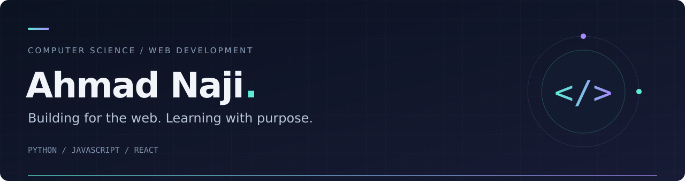

  

  
  

## About

I'm **Ahmad Naji**, a computer science student focused on web development. I enjoy building useful interfaces, working with databases, and connecting the front end to the back end.

I'm currently working on a **MERN stack project** and learning **Django** and **Next.js**. My longer-term interests include artificial intelligence and data science.

## Selected work

<table>
<tr>
<td width="50%" valign="top">
<h3><a href="https://github.com/ahmadnajee/OmniFood">OmniFood</a></h3>

A food website project from my web development journey.

<a href="https://github.com/ahmadnajee/OmniFood">Explore repository →</a>
</td>
<td width="50%" valign="top">
<h3><a href="https://github.com/ahmadnajee/Weather-Application">Weather Application</a></h3>

A weather application project.

<a href="https://github.com/ahmadnajee/Weather-Application">Explore repository →</a>
</td>
</tr>
<tr>
<td width="50%" valign="top">
<h3><a href="https://github.com/ahmadnajee/Pig-Game">Pig Game</a></h3>

A game project from my programming practice.

<a href="https://github.com/ahmadnajee/Pig-Game">Explore repository →</a>
</td>
<td width="50%" valign="top">
<h3><a href="https://github.com/ahmadnajee/100-Day-with-Python">100 Days of Python</a></h3>

Python exercises and small projects documenting my learning.

<a href="https://github.com/ahmadnajee/100-Day-with-Python">Explore repository →</a>
</td>
</tr>
</table>

## Technologies

| Area | Technologies |
| :--- | :--- |
| Front end | HTML, CSS, JavaScript, React, Tailwind CSS |
| Back end | Python, Node.js, Express |
| Databases | PostgreSQL, MySQL, MongoDB |
| Tools | Git, GitHub, Postman |
| Learning | Django, Next.js |

## Contribution activity

<!-- Generated by .github/workflows/contributions.yml after its first successful run. -->
<picture>
  <source media="(prefers-color-scheme: dark)" srcset="https://raw.githubusercontent.com/ahmadnajee/ahmadnajee/profile-assets/github-snake-dark.svg" />
  <source media="(prefers-color-scheme: light)" srcset="https://raw.githubusercontent.com/ahmadnajee/ahmadnajee/profile-assets/github-snake.svg" />
  
</picture>

## Connect

I'm interested in practical web projects, thoughtful collaboration, and opportunities to grow as a developer.

[ahmadnajee373@gmail.com](mailto:ahmadnajee373@gmail.com)
